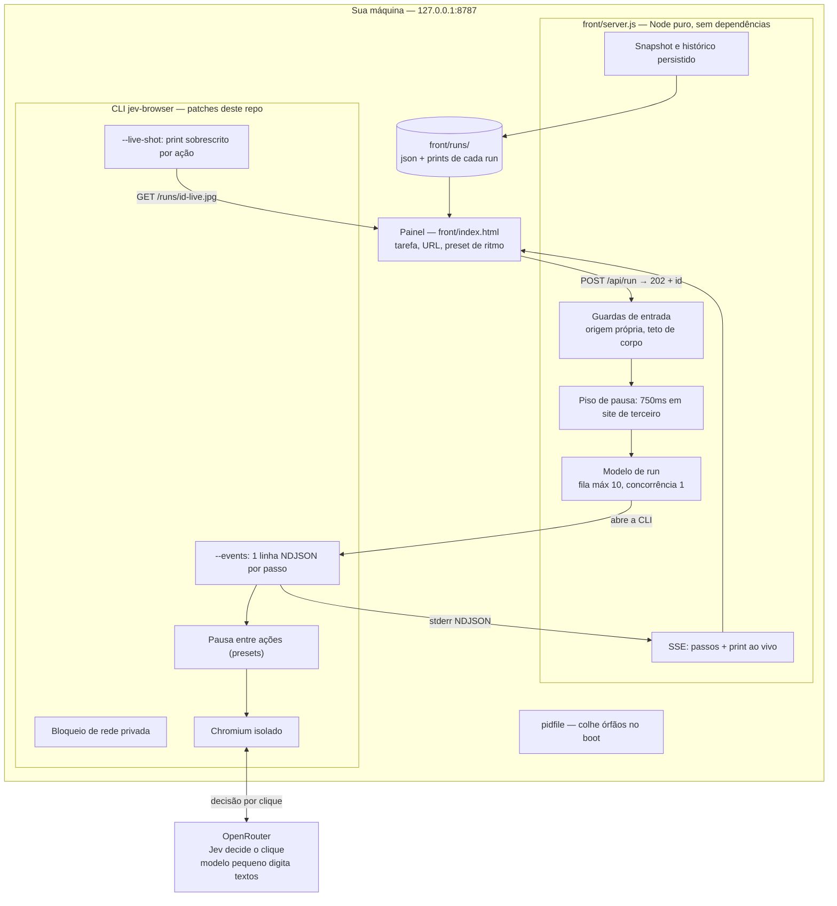
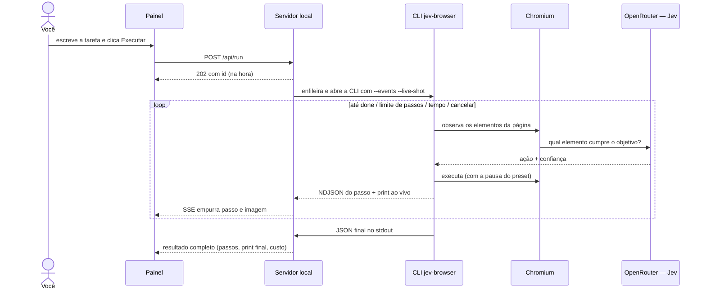

# open-jev-browser — painel local e comandar o Chrome com o Jev

[](https://github.com/Kekeu-u/open-jev-browser/actions/workflows/ci.yml) [](LICENSE)

Automation de navegador controlada por comandos em português, com o [Jev](https://docs.typesafe.ai) (via OpenRouter) decidindo cada clique em ~0,3–0,5s por uma fração de centavo. Dois modos independentes, uma CLI, um painel web local e uma extensão Chrome.

> Projeto de conhecimento/testes na máquina do próprio usuário. Não é produto; use por sua conta e risco, respeitando os termos dos sites que visitar.

## Os dois modos

| Modo | O que usa | Pra quê |
| --- | --- | --- |
| **Painel local** (`front/`) | Chromium isolado, sem seus logins | Pesquisa, leitura, formulários, testes — reproduzível e descartável |
| **Extensão** (`jev-browser-control/extension/`) | Seu Chrome real, com suas sessões | Tarefas logadas: analytics, gerenciar próprio conteúdo, leitura |

Os modos ficam separados de propósito (decisão de arquitetura revisada externamente): unificar dobraria a manutenção sem ganho real. O contrato compartilhado entre eles está em [`jev-browser/EVENTS-SCHEMA.md`](jev-browser/EVENTS-SCHEMA.md).

## Arquitetura



Ciclo de vida de um comando:



Estados de um run: `queued → running → done | error | blocked | max_steps | timeout | stuck | cancelled | interrupted`. Cada run terminal vira `front/runs/<id>.json` + print; retenção dos 20 mais recentes.

## Instalação rápida (Node 22+; Windows, macOS e Linux)

**Primeira vez — um comando só** (instala o que faltar, cria o ícone na área de trabalho e sobe o painel):

```sh
node jev.mjs tudo        # Windows também: duplo clique em instalar.bat
```

Dia a dia: **clique no ícone "jev browser"** na área de trabalho (Linux: menu de aplicativos), ou `node jev.mjs start`. Os demais comandos:

```sh
node jev.mjs start     # sobe o serviço e abre o painel (ja rodando? só abre)
node jev.mjs status    # estado: rodando/parado, pid, chave, fila
node jev.mjs stop      # para TUDO: servidor, CLI e Chromium, sem órfãos
node jev.mjs extensao  # prepara a instalação da extensão no seu Chrome
node jev.mjs atalho    # só recria o ícone da área de trabalho
```

Atalhos por sistema: **Windows** — duplo clique em `start.bat` ou `jev.bat start`; **macOS/Linux** — `./jev start` (dá `chmod +x jev` uma vez).

O que o supervisor garante:

- **Instância única** — segundo `start` não duplica serviço; só abre o painel de novo.
- **Guia única** — cada guia aberta mantém um batimento (`/api/heartbeat`); se o painel já está aberto em alguma guia, `start` não abre outra (e o painel avisa quantas guias existem).
- **Serviço desacoplado** — feche o terminal, o serviço continua; log da sessão em `front/runs/server.log`.
- **Desligamento completo** — `stop` derruba a cadeia inteira (Windows: `taskkill /T`; POSIX: kill do grupo de processo) e remove o pidfile. Órfãos de crash são colhidos no próximo boot via pidfile.

Depois do `setup`, falta só o passo manual: a **chave do cérebro** (o modelo Jev) — do [OpenRouter](https://openrouter.ai/settings/keys) (`sk-or-…`) ou da [TypeSafe](https://console.typesafe.ai/settings/keys) (`ts_…`), colada pelo próprio painel (botão "chave" no topo) ou em `front/.env`. Só a do OpenRouter tem validação automática ao salvar; com só a TypeSafe, o painel desliga a digitação de textos automaticamente (a TypeSafe decide, não digita). A chave nunca vai para a página — só no env do processo filho, e qualquer eco é redigido.

**Extensão (seu Chrome do dia a dia, com seus logins):** rode `node jev.mjs extensao` — abre o Chrome em `chrome://extensions`, a pasta certa no Explorer e a chave no Bloco de Notas; restam só os cliques: modo desenvolvedor → carregar sem compactação (pasta `jev-browser-control/extension`) → Opções → colar a chave → Test connection. Para comandar por agente (MCP), registre `node jev-browser-control/mcp/server.mjs` com `JBC_MODE=extension`.

## Uso

Escreva a tarefa em linguagem natural, escolha o ritmo e execute:

- **Observar** (2s entre ações): acompanhar ao vivo e poder intervir.
- **Padrão** (0,8s): uso normal.
- **Rápido** (0): só em hosts próprios (localhost, `*.local`, `FAST_HOSTS` no `.env`); em site de terceiro o servidor impõe o piso de 750ms.

Durante o run: passos em tempo real, print ao vivo, botão cancelar. Depois: histórico que sobrevive a restart, print final, página em markdown, custo estimado.

## Segurança e política de design

- Origem própria exigida em toda rota; navegação digitada só abre a página `/`.
- A chave é redigida de qualquer eco; segredo só por env.
- Kill da árvore de processo no Windows (nenhum Chromium órfão), pidfile para colher órfãos de crash.
- O agente em modo isolado **não alcança rede privada** (painel, roteador, metadata) — fecha exfiltração por prompt injection. Escape: `JEV_BROWSER_ALLOW_PRIVATE_NET=1`.
- **Pausa fixa, sem jitter.** O ritmo é cortesia com o site visitado, não disfarce de humano. Randomização com propósito de enganar detector é explicitamente fora do escopo deste projeto.
- **Sem automação de engajamento.** Rolar feed, curtir, comentar ou seguir em volume por bot viola os termos das plataformas e queima contas; este repo não implementa nem aceita patches para isso. A superfície suportada: pesquisa, leitura, analytics, gerenciamento do próprio conteúdo e moderação dos próprios canais.
- Forks são livres (veja licenças abaixo); os limites acima são decisões deste projeto, não limites da licença.

## Estrutura

```
jev browser/
├── jev.mjs                   # supervisor multiplataforma: start/stop/status/setup
├── jev.bat / jev / start.bat # atalhos por OS (delegam ao supervisor)
├── front/                     # painel: server.js (Node puro) + index.html
│   ├── .env.example           # configure a chave aqui
│   ├── test/                  # teste de fumaça do servidor (node --test)
│   └── runs/                  # histórico: <id>.json + prints + server.log
├── jev-browser/               # fork do jkudish/jev-browser (MIT) com patches:
│   │                          #   --events, --live-shot, pausa entre ações,
│   │                          #   bloqueio de rede privada
│   └── EVENTS-SCHEMA.md       # contrato compartilhado (SSOT dos eventos)
├── jev-browser-control/       # clone do nexibeo/jev-browser-control (MIT):
│   │                          #   extensão Chrome + MCP pro Chrome real
│   │                          #   (nosso chat lateral com modos está aqui)
├── native/                    # controle de COMPUTADOR multiplataforma (nut.js):
│   │                          #   mouse, teclado, captura de tela, janelas.
│   │                          #   CLI e API — fundação do app nativo híbrido
└── prompts-sonnet.md          # prompts de revisão usados durante o build
```

## Créditos e licenças

- [`jkudish/jev-browser`](https://github.com/jkudish/jev-browser) — MIT. Base da CLI; os patches deste repo estão nos arquivos citados acima.
- [`nexibeo/jev-browser-control`](https://github.com/nexibeo/jev-browser-control) — MIT. Extensão e MCP do modo Chrome real.
- Os acréscimos próprios (supervisor, front, patches, docs) estão sob a [licença MIT](LICENSE).

## Estado e roadmap

Feito: eventos ao vivo, fila com cancelamento, histórico persistido, presets com piso no servidor, print ao vivo, hardening de segurança (2 revisões independentes + 1 externa), chat LLM no painel lateral da extensão (modos Navegador/Computador) e **`native/`**: controle de computador multiplataforma via nut.js (mouse, teclado, tela, janelas — CLI e API), a fundação do modo Computador.

Próximo degrau do modo híbrido: o app nativo com os botões **Navegador / Computador / Híbrido** — ele controla o PC via `native/` e o navegador via ponte da extensão (10522). A extensão sozinha nunca controla o computador (sandbox do Chrome).

**Subagentes isolados (roadmap):** rodar N agentes em paralelo, cada um com navegador próprio e seus acessos separados em **grupos de guias nomeados por agente** (a extensão já agrupa abas; falta nomear por agente e permitir concorrência por aba-grupo). Junto, um **governador de hardware local** (sem telemetria, sem nuvem): mede RAM/CPU livres na máquina antes de subir cada subagente e recusa/engarafa quando falta recurso — ex.: 200 MB livres não sobrevive a mais um Chromium; o governador admite novos agentes só dentro do orçamento, com limite configurável no painel. Cuidado de design: paralelismo multiplica carga sobre sites de terceiros — manter limites globais de passos/ritmo somando todos os agentes.

Fora do escopo por decisão de design: jitter/"humanização" de ritmo, engajamento automático em redes sociais, unificação dos dois modos.
